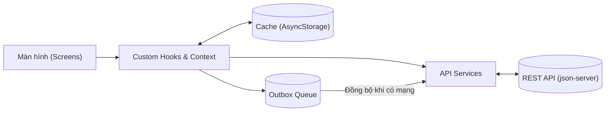

### Các bước khởi chạy dự án

#### Bước 1: Cài đặt các gói phụ thuộc
Tại thư mục gốc của dự án, mở Terminal và chạy:
```bash
npm install
```

#### Bước 2: Khởi động Mock REST API Server (json-server)
Mở một cửa sổ Terminal riêng và chạy lệnh:
```bash
npm run server
```
* Server sẽ chạy tại địa chỉ: `http://localhost:3000` (được cấu hình độ trễ 800ms theo yêu cầu đề bài).
* Máy ảo Android Emulator kết nối qua địa chỉ: `http://10.0.2.2:3000`.
* File dữ liệu nguồn: `db.json`.

#### Bước 3: Khởi động ứng dụng React Native trên Android
Mở một cửa sổ Terminal thứ hai và chạy:
```bash
npm run android
```

---

## 2. Sơ đồ luồng dữ liệu (Data Flow)

Kiến trúc ứng dụng tuân thủ mô hình phân lớp rõ ràng: **Màn hình $\rightarrow$ Hook $\rightarrow$ Service $\rightarrow$ Cache / Outbox $\rightarrow$ API**.



### Chi tiết 2 luồng xử lý chính:

1. **Luồng đọc dữ liệu (Cache-First):**
   * Màn hình gọi hook `useCachedQuery`.
   * Hook đọc ngay dữ liệu từ `AsyncStorage Cache` để hiển thị tức thì (UI không bị trắng/chờ).
   * Đồng thời, nếu thiết bị đang online và cache hết hạn (hoặc khi người dùng Pull-to-refresh), hook gọi `Service` gửi request lên `REST API Server`.
   * Khi API phản hồi thành công, dữ liệu mới sẽ được ghi đè vào cache và cập nhật lại giao diện.
   * Nếu offline hoặc server lỗi: app tiếp tục sử dụng dữ liệu từ cache kèm thanh thông báo `OfflineBanner`.

2. **Luồng ghi dữ liệu (Optimistic Update & Outbox Queue):**
   * Khi người dùng thực hiện thao tác (đổi trạng thái bài tập, thêm bài tập mới, sửa hồ sơ):
   * Giao diện cập nhật ngay lập tức (**Optimistic UI**) và hiển thị nhãn `Chưa đồng bộ`.
   * Dữ liệu được ghi ngay vào Cache cục bộ và thêm vào hàng đợi **Outbox Queue** trong `AsyncStorage`.
   * Khi có kết nối mạng, hook `useOutboxSync` sẽ tự động lấy các tác vụ trong Outbox gửi tuần tự lên REST API Server. Khi thành công, tác vụ được xóa khỏi Outbox và nhãn "Chưa đồng bộ" biến mất.

---

## 3. Cơ chế xử lý xung đột dữ liệu (Mục B5)

Khi thiết bị hoạt động ở chế độ Offline, người dùng có thể thực hiện thay đổi dữ liệu cục bộ. Trong khi đó, dữ liệu trên máy chủ cũng có thể đã bị chỉnh sửa bởi một phiên làm việc khác.

Ứng dụng xử lý xung đột dựa trên trường dấu thời gian **`updatedAt`** theo cơ chế sau:

1. **Gắn nhãn thời gian thao tác:**
   * Mỗi thao tác thay đổi dữ liệu khi offline được gán `updatedAt` tại thời điểm thực hiện trên thiết bị ($T_{local}$).
2. **Kiểm tra khi kết nối lại mạng (Hook `useOutboxSync`):**
   * Khi có mạng, trước khi gửi yêu cầu ghi đè (PUT/PATCH), ứng dụng thực hiện truy vấn dữ liệu hiện tại trên máy chủ ($D_{server}$) có chứa trường $T_{server}$ (`updatedAt`).
3. **So sánh và giải quyết xung đột:**
   * **Trường hợp 1 ($T_{server} > T_{local}$): Xảy ra xung đột!**
     * Dữ liệu trên server mới hơn thao tác offline của người dùng.
     * **Quyết định:** Ưu tiên dữ liệu trên server. Ứng dụng hủy bỏ thao tác trong Outbox, không ghi đè lên server.
     * Cập nhật lại cache cục bộ theo dữ liệu mới nhất từ server.
     * Hiển thị hộp thoại cảnh báo (`Alert`) thông báo cho người dùng:
       > *"Phát hiện xung đột dữ liệu! Dữ liệu trên máy chủ mới hơn thao tác ngoại tuyến của bạn. Ứng dụng đã tự động cập nhật theo máy chủ."*
   * **Trường hợp 2 ($T_{server} \le T_{local}$): Không có xung đột.**
     * Thao tác offline của người dùng là mới nhất.
     * Ứng dụng tiến hành cập nhật lên server bình thường và xóa tác vụ khỏi Outbox.

---